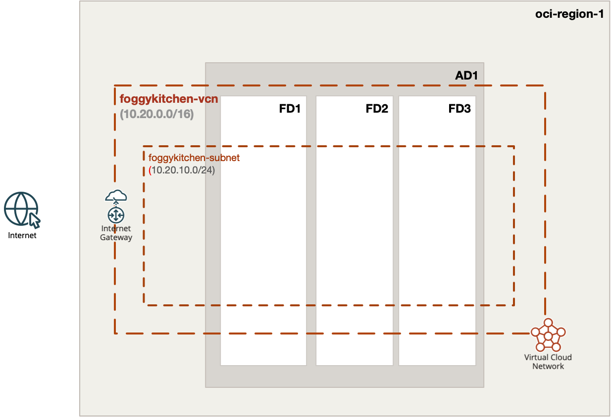
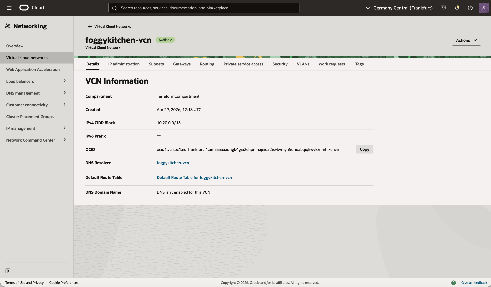
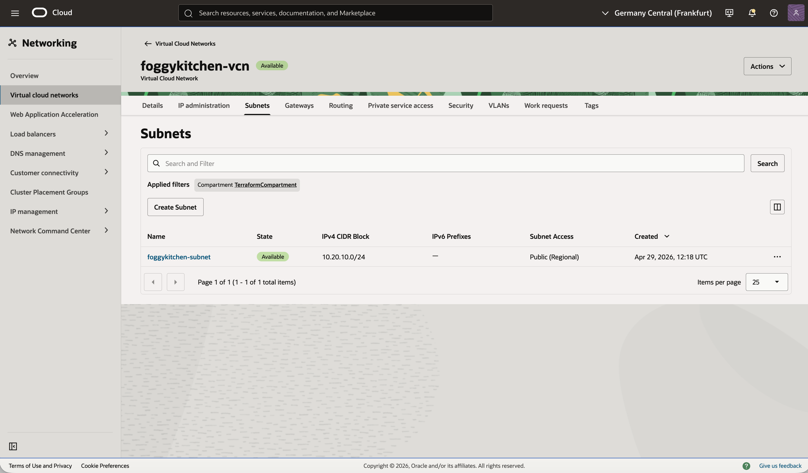
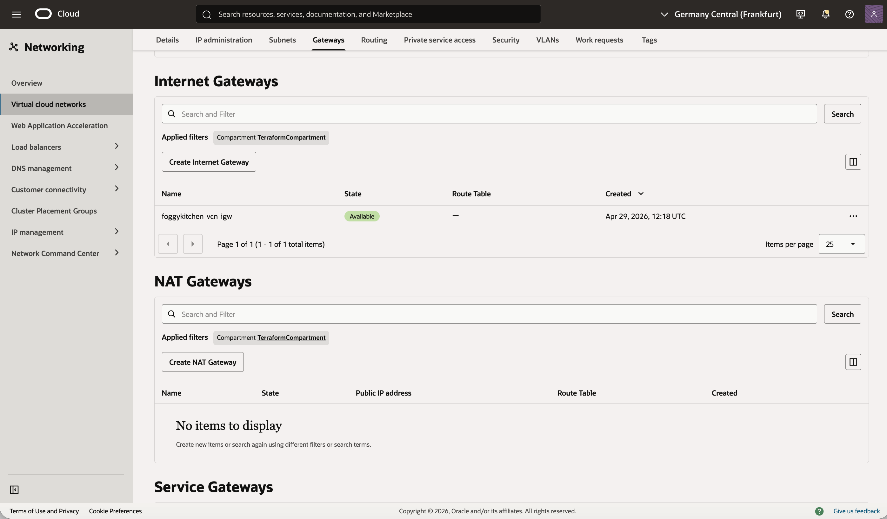

# Example 01: Basic OCI VCN

Deploy the network foundation with the local `terraform-oci-fk-vcn` checkout. This example creates one VCN, one regional public subnet, an Internet Gateway and a route table pointing `0.0.0.0/0` at that gateway. It uses the VCN's default security list and DHCP options.

## Architecture



| Component | Configuration |
| --- | --- |
| VCN | `foggykitchen-vcn`, `10.20.0.0/16` |
| Public subnet | `foggykitchen-subnet`, `10.20.10.0/24` |
| Default route | Internet Gateway |
| DHCP | VCN-generated default |

The example creates no compute instance, load balancer, OKE cluster, NAT Gateway or Service Gateway. Example [02](../02-oke-networking-integration/README.md) adds a Kubernetes workload; example [03](../03-custom-dhcp-options/README.md) demonstrates custom DHCP.

## Run with OpenTofu

Use OpenTofu >= 1.6 and OCI API-key credentials with network permissions. See the [authentication instructions](../README.md#requirements-and-authentication).

```sh
cp terraform.tfvars.example terraform.tfvars
# Edit the copied file with your OCI configuration.
tofu init
tofu fmt -check
tofu validate
tofu plan -out=basic-vcn.tfplan
# Review before deployment.
tofu apply basic-vcn.tfplan
tofu output
```

Outputs are `vcn_id` and the `subnet_ids` map. This example uses its own state; it does not update another example's deployment.

## OCI Console illustrations

These screenshots illustrate the basic VCN layout; names and console appearance can vary.





## Cleanup

Review `tofu plan -destroy` and run `tofu destroy` when finished. Keep credentials, variable files, state and plans private.

[All examples](../README.md) · [Module contract](../../README.md)

## Support and license

See the [support policy](../../SUPPORT.md) and [UPL license](../../LICENSE).

© 2026 [FoggyKitchen.com](https://foggykitchen.com) - Cloud. Code. Clarity.
