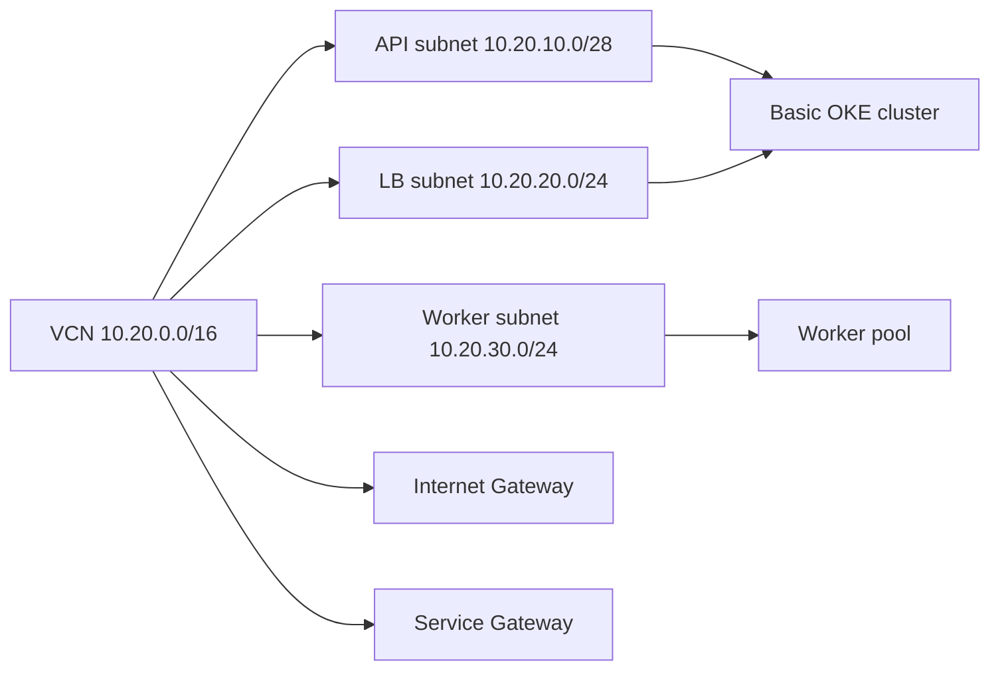

# Example 02: OKE networking integration

Compose the local `terraform-oci-fk-vcn` checkout with [terraform-oci-fk-oke v0.3.0](https://github.com/foggykitchen/terraform-oci-fk-oke/tree/v0.3.0). The VCN module owns the VCN, subnets, gateways, route table and security lists. OKE consumes those outputs through `use_existing_vcn = true` and creates a Basic cluster with a worker pool.

## Architecture



All three subnets allow public VNICs in this training layout. The API endpoint and worker nodes use public placement; review the security lists and public access before applying. This example does not create a load balancer just by creating the LB subnet. It creates no NAT Gateway or custom DHCP set.

## Module composition

| File | Responsibility |
| --- | --- |
| `networking.tf` | Local VCN module, API/LB/worker subnets, gateways, routing and security lists |
| `oke.tf` | Pinned OKE module, existing VCN/subnet inputs and Basic cluster settings |
| `providers.tf` | OCI API-key provider and version constraints |
| `variables.tf` | Authentication, region/compartment and Kubernetes version inputs |
| `outputs.tf` | Network IDs, cluster ID and sensitive kubeconfig |

The Oracle Services Network CIDR used by security lists is discovered from OCI services. The `all-services` shorthand remains only in the VCN module route rule, where the module resolves it. This example supplies no NSG IDs; access is controlled through the subnet security lists. `use_existing_nsg = false` disables optional pod/virtual-node NSG inputs rather than creating NSGs.

## Requirements and inputs

Use OpenTofu >= 1.6, Git and an OCI user with networking and OKE permissions. Review service limits, A1 Flex capacity and OKE versions in the target region. The example requests `VM.Standard.A1.Flex` workers with Oracle Linux 8.10, one OCPU and 4 GB per worker. The pinned module defaults to one pool with three workers.

`k8s_version` defaults to `v1.35.2`; override it with a version currently offered by your region. The module receives `region` explicitly. The module release is pinned so that later upstream changes do not silently change this example's interface.

## Run with OpenTofu

```sh
cp terraform.tfvars.example terraform.tfvars
# Edit API-key inputs, compartment and region; review k8s_version.
tofu init
tofu fmt -check
tofu validate
tofu plan -out=oke.tfplan
# Review the cluster, worker and networking operations.
tofu apply oke.tfplan
tofu output cluster_id
```

See the [shared authentication instructions](../README.md#requirements-and-authentication). Keep actual credentials, variable files, state, plans and kubeconfig out of Git. To save kubeconfig locally after deployment:

```sh
umask 077
tofu output -raw kubeconfig > kubeconfig
```

Outputs include `vcn_id`, `subnet_ids`, `security_list_ids`, `route_table_ids`, `cluster_id` and sensitive `kubeconfig`. Cluster ID is taken from the pinned module's `cluster.id` output.

## Validation and cleanup

Initialization and `tofu validate` check the module contract; they do not prove regional Kubernetes availability or a successful live cluster deployment. This repository's DHCP mock tests are separate from live OKE validation.

Review `tofu plan -destroy` and run `tofu destroy` after the lab. Worker VMs and boot volumes are billable. Remove any workloads you created separately and keep kubeconfig private.

[All examples](../README.md) · [01: Basic VCN](../01-basic-vcn/README.md) · [03: Custom DHCP](../03-custom-dhcp-options/README.md)

## Support and license

See the [support policy](../../SUPPORT.md) and [UPL license](../../LICENSE).

© 2026 [FoggyKitchen.com](https://foggykitchen.com) - Cloud. Code. Clarity.
